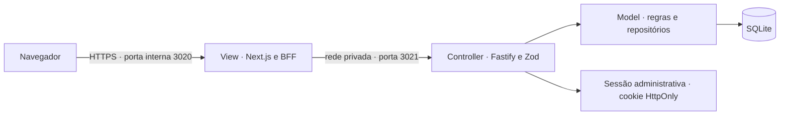

# Doce & Afeto — E-commerce de Cupcakes

Loja de cupcakes desenvolvida como projeto acadêmico. O sistema reúne catálogo, carrinho, pedidos, pagamentos simulados, acompanhamento de entrega, avaliações do site e painel administrativo.

## Tecnologias

| Camada                    | Tecnologias                                                                                                        |
| ------------------------- | ------------------------------------------------------------------------------------------------------------------ |
| Frontend (`View/`)        | Next.js 16 com App Router, React 19, TypeScript, Tailwind CSS 4, Zod, Context API, React-Toastify e `fetch` nativo |
| API (`Controller/`)       | Node.js, TypeScript, Fastify 5, Zod, `@fastify/cookie` e `@fastify/cors`                                           |
| Dados e regras (`Model/`) | SQLite, `better-sqlite3`, migrações SQL e cálculos monetários em centavos                                          |
| Testes                    | Vitest para testes unitários e de integração; Playwright para fluxos no navegador                                  |

Os três diretórios são pacotes de um monorepo com npm workspaces. O navegador chama o BFF no Next.js; ele encaminha somente as rotas da loja para o Fastify pela rede privada. O Controller valida os dados e usa o Model para acessar o banco e aplicar as regras do pedido.

## Arquitetura



## Funcionalidades

- **Catálogo:** dez cupcakes com fotos locais, busca por nome, filtro por categoria e página de detalhes.
- **Carrinho:** adicionar, alterar quantidade e remover produtos; os itens são mantidos no armazenamento local do navegador.
- **Checkout:** formulário de entrega, validação de dados e cálculo de subtotal, frete fixo de R$ 8,90 e total no servidor.
- **Pagamento simulado:** escolha entre Pix, boleto e cartão de crédito. Os três cartões de demonstração permitem testar aprovação, recusa por limite e recusa genérica. Não há cobrança real.
- **Acompanhamento:** cada pedido recebe um token público para consultar o pagamento e o andamento da entrega.
- **Avaliações:** formulário com nome, data, relatos, nota de 1 a 5 estrelas e captura de tela opcional de até 3 MB. A autorização de publicação controla quais avaliações aparecem na home e nas páginas públicas; os detalhes são somente para leitura.
- **Painel administrativo:** login com usuário e senha, sessão de 10 minutos, consulta de avaliações, filtro de pedidos por status e avanço da entrega. O acesso `convidado` vê pedidos pagos. O acesso oficial vê todos os pedidos e pode excluir pedidos e avaliações após confirmação.
- **Interface:** layout responsivo, favicon de cupcake, estados de carregamento, vazio e erro, mensagens de confirmação e navegação por teclado.

### Cartões de demonstração

| Número                | Resultado                        |
| --------------------- | -------------------------------- |
| `4242 4242 4242 4242` | Aprovado                         |
| `4000 0000 0000 9995` | Recusado por limite insuficiente |
| `4000 0000 0000 0002` | Recusado                         |

## Executar localmente

Requisitos: Node.js 22 ou superior, abaixo da versão 27, e npm.

```bash
npm ci
npm run dev
```

Na primeira execução, o projeto cria o arquivo `.env` local, aplica as migrações no SQLite e carrega o catálogo inicial. `npm run dev` inicia o frontend em `http://127.0.0.1:3020` e a API em `127.0.0.1:3021`. Abra a porta 3020 no navegador; as chamadas do navegador passam pelo BFF do Next.js. Se houver processos antigos nas portas 3000 ou 3333, encerre-os para não abrir uma versão anterior da loja por engano.

O usuário inicial do login é `convidado`, com senha de demonstração `12345678`. Para habilitar o acesso oficial, defina `OFFICIAL_ADMIN_USERNAME` e `OFFICIAL_ADMIN_PASSWORD` no `.env` local. Esse arquivo não deve ser versionado. As sessões administrativas expiram após 10 minutos.

As variáveis principais são:

| Variável                                              | Finalidade                                              |
| ----------------------------------------------------- | ------------------------------------------------------- |
| `DATABASE_PATH`                                       | Caminho do SQLite; padrão: `Model/data/cupcakes.sqlite` |
| `API_PORT` e `WEB_ORIGIN`                             | Porta da API e origem do frontend no desenvolvimento    |
| `ADMIN_PASSWORD`                                      | Senha do usuário `convidado`                            |
| `OFFICIAL_ADMIN_USERNAME` e `OFFICIAL_ADMIN_PASSWORD` | Credenciais do acesso oficial                           |
| `ADMIN_SESSION_KEY`                                   | Chave usada nas sessões administrativas                 |
| `NEXT_PUBLIC_DEMO_ADMIN_PASSWORD`                     | Senha de demonstração exibida na dica do menu           |
| `API_INTERNAL_ORIGIN`                                 | Endereço interno do Fastify para o BFF                  |
| `PORT` e `HOST`                                       | Porta e endereço do servidor combinado                  |

Para servir frontend e API na mesma origem, após compilar:

```bash
npm run build
npm run start:combined
```

## Publicar na VPS com Coolify

O arquivo [`compose.coolify.yaml`](compose.coolify.yaml) cria dois serviços: `frontend`, na porta interna 3020, e `api`, na porta interna 3021. O domínio HTTPS deve apontar **somente para `frontend:3020`**. A API não tem domínio nem porta publicada no host; ela participa apenas da rede privada `backend`. O banco SQLite usa o volume `cupcakes_data`, que mantém pedidos e avaliações após reinicializações e novos deploys. O Dockerfile não inclui o `.env` nem o banco local na imagem.

1. No Coolify, crie uma aplicação **Docker Compose a partir do Git**, usando `compose.coolify.yaml` na raiz do repositório. Mantenha o modo de deploy padrão, sem **Raw Compose**.
2. Configure no Coolify as variáveis `ADMIN_PASSWORD`, `ADMIN_SESSION_KEY` e `OFFICIAL_ADMIN_PASSWORD` com valores novos. `OFFICIAL_ADMIN_USERNAME` usa `engenheiro` por padrão. Não copie o `.env` local para a VPS.
3. Em **Domains**, adicione seu domínio HTTPS ao serviço `frontend`, apontando para a porta interna **3020**. Não atribua domínio ao serviço `api` e não publique `3021` em **Ports**. O Coolify encaminha o domínio ao contêiner por sua rede Docker; não é preciso abrir 3020 ou 3021 no firewall da VPS.
4. Faça o deploy e confira o catálogo, o login dos dois perfis e o envio de uma avaliação. O health check da API roda apenas dentro da rede privada.

O BFF aceita apenas os métodos e caminhos usados pela aplicação, limita o corpo a 4,5 MB e encaminha o cookie administrativo. A validação completa dos campos, a autorização e os cálculos continuam no Fastify. As rotas `/api/v1/*` do BFF são públicas na origem do frontend para que a interface funcione; o processo Fastify em `api:3021` não fica acessível diretamente pela internet. Consulte a [documentação de Docker Compose do Coolify](https://coolify.io/docs/applications/builds/docker-compose).

## Rotas do frontend

| Rota                    | Conteúdo                                                                |
| ----------------------- | ----------------------------------------------------------------------- |
| `/`                     | Vitrine, busca, categorias e avaliações públicas abaixo dos produtos    |
| `/produtos/:slug`       | Detalhes de um cupcake                                                  |
| `/carrinho`             | Itens e quantidades do carrinho                                         |
| `/checkout`             | Dados de entrega e pagamento simulado                                   |
| `/pedido/:token`        | Acompanhamento de um pedido pelo token público                          |
| `/avaliacoes`           | Lista de avaliações autorizadas para publicação                         |
| `/avaliacoes/:id`       | Detalhes de uma avaliação pública                                       |
| `/admin`                | Login do convidado ou do acesso oficial                                 |
| `/admin/pedidos`        | Pedidos, filtros, andamento da entrega e exclusão para o acesso oficial |
| `/admin/avaliacoes`     | Lista completa de avaliações recebidas                                  |
| `/admin/avaliacoes/:id` | Detalhes e exclusão de avaliação para o acesso oficial                  |

## Endpoints da API

Todos os endpoints abaixo têm o prefixo `/api/v1`. O navegador usa a mesma origem do frontend, com encaminhamento pelo BFF. Na VPS, o Fastify escuta somente na rede privada em `api:3021`. `:id`, `:slug` e `:publicToken` representam parâmetros de rota.

| Método   | Endpoint                     | Função                                                   | Acesso                      |
| -------- | ---------------------------- | -------------------------------------------------------- | --------------------------- |
| `GET`    | `/health`                    | Estado da API; usado apenas no contêiner interno         | Interno                     |
| `GET`    | `/products`                  | Listar produtos ativos; aceita `q` e `category`          | Público                     |
| `GET`    | `/products/:slug`            | Detalhes de um produto ativo                             | Público                     |
| `POST`   | `/orders`                    | Criar pedido; valores calculados no servidor             | Público                     |
| `POST`   | `/orders/:id/pay`            | Simular pagamento com `publicToken` e método no corpo    | Token do pedido             |
| `GET`    | `/orders/track/:publicToken` | Consultar pedido e entrega                               | Token do pedido             |
| `POST`   | `/site-reviews`              | Enviar avaliação e captura opcional                      | Público                     |
| `GET`    | `/site-reviews`              | Listar avaliações autorizadas para publicação            | Público                     |
| `GET`    | `/site-reviews/:id`          | Detalhes de uma avaliação pública                        | Público                     |
| `POST`   | `/admin/login`               | Autenticar usuário e senha; criar cookie de sessão       | Credenciais administrativas |
| `GET`    | `/admin/session`             | Consultar papel e validade da sessão                     | Sessão administrativa       |
| `POST`   | `/admin/logout`              | Encerrar sessão                                          | Cookie opcional             |
| `GET`    | `/admin/orders`              | Listar pagos para convidado ou todos para acesso oficial | Sessão administrativa       |
| `PATCH`  | `/admin/orders/:id/status`   | Avançar o estado de entrega                              | Sessão administrativa       |
| `DELETE` | `/admin/orders/:id`          | Excluir pedido, itens e tentativas de pagamento          | Acesso oficial              |
| `GET`    | `/admin/site-reviews`        | Listar todas as avaliações, inclusive privadas           | Sessão administrativa       |
| `GET`    | `/admin/site-reviews/:id`    | Consultar uma avaliação completa                         | Sessão administrativa       |
| `DELETE` | `/admin/site-reviews/:id`    | Excluir avaliação e captura                              | Acesso oficial              |

As rotas administrativas retornam `401` quando a sessão é inválida ou expira. A exclusão retorna `403` para o usuário `convidado`.

## Armazenamento

O SQLite fica, por padrão, em `Model/data/cupcakes.sqlite`. Pedidos, itens, tentativas de pagamento e avaliações são armazenados no banco. As capturas enviadas nas avaliações ficam na coluna `screenshot_data` da tabela `site_reviews`, junto com o tipo do arquivo em `screenshot_mime`; não há uma pasta separada de imagens enviadas.

## Comandos de manutenção e testes

```bash
npm run db:migrate   # aplicar migrações
npm run db:seed      # restaurar o catálogo inicial
npm run lint
npm run typecheck
npm run build
npm run test
npx playwright install chromium
npm run test:e2e
```

Os testes E2E usam um banco SQLite isolado e não alteram o banco local da loja.
